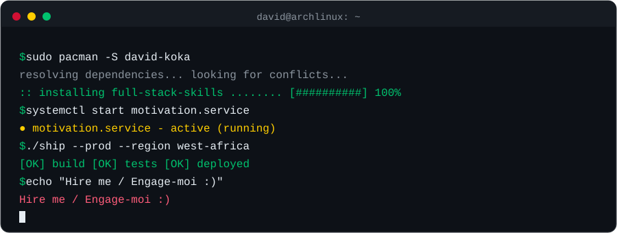
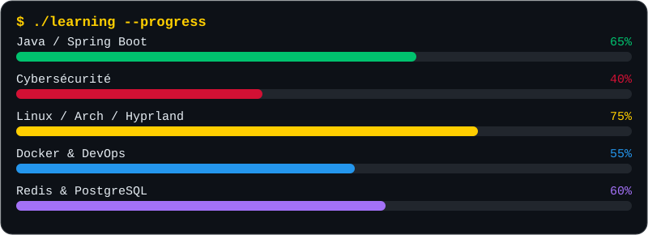
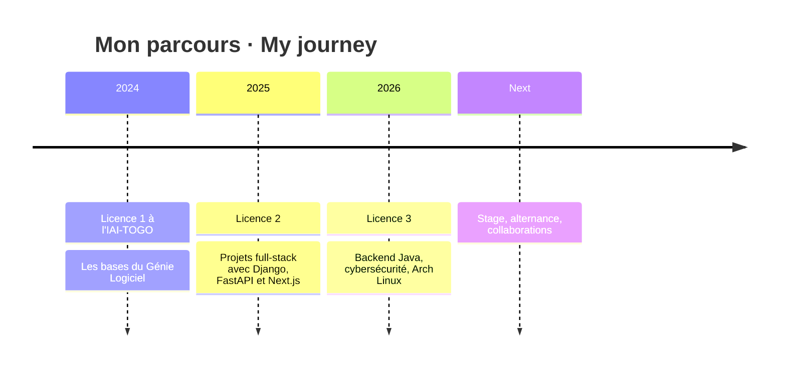
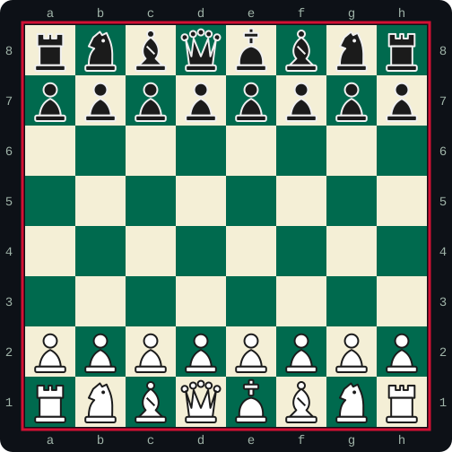

<!-- ═══════════════ HEADER (Togo 🇹🇬 matrix glitch) ═══════════════ -->
<p align="center">
  
</p>

<p align="center">
  
</p>

<p align="center">
  
  
  
</p>

<p align="center">
  <a href="https://www.linkedin.com/in/davidkoka"></a>
  <a href="https://devdav.vercel.app/"></a>
  <a href="https://github.com/devDav65"></a>
</p>


<!-- ═══════════════ À PROPOS ═══════════════ -->
## 👨‍💻 À propos de moi · About me

🇫🇷 **Français**
- 🎓 Étudiant en Génie Logiciel à **Lomé, Togo**
- 🔥 Dev **Full-Stack** : j'aime autant le backend (Java/Spring, Django, FastAPI) que le front (Next.js)
- 🌍 Je construis des solutions pour le **contexte africain** (FCFA, fintech, santé, immobilier…)
- 🐧 Utilisateur d'**Arch Linux** (oui, je vais te le dire)
- 🔐 Curieux de **cybersécurité** et d'**admin système**
- ⚡ Fun fact : je transforme les bugs en features

🇬🇧 **English**
- 🎓 Software Engineering student based in **Lomé, Togo**
- 🔥 **Full-Stack** dev: backend (Java/Spring, Django, FastAPI) and frontend (Next.js)
- 🌍 Building solutions for the **African context** (payments, health, real estate…)
- 🐧 **Arch Linux** user (yes, I'll tell you)
- 🔐 Into **cybersecurity** and **sysadmin**

<p align="center">
  
</p>

### 🐧 `neofetch`

```bash
david@archlinux:~$ neofetch

        /\          david@archlinux
       /  \         ────────────────────────────────────
      /\   \        OS ......... Arch Linux (btw)
     /      \       WM ......... Hyprland + Caelestia (Quickshell)
    /   ,,   \      Shell ...... fish
   /   |  |  -\     Role ....... Full-Stack Developer
  /_-''    ''-_\    Langages ... Java · Python · JavaScript
                    Stack ...... Spring Boot · Django · FastAPI · Next.js
                    Data ....... PostgreSQL · Redis
                    Ship ....... Docker
                    Home ....... Lomé, Togo 🇹🇬
                    Status ..... ☕ chargé en café, prêt à compiler
```


<!-- ═══════════════ STACK ═══════════════ -->
## 🛠️ Ma stack · My stack

<p align="center">
  
</p>

<p align="center">
  
  
  
  
  
  
  
  
  
  
  
  
</p>

### 💬 Demande-moi / Ask me about

`Django & DRF` · `FastAPI` · `Next.js` · `Docker` · `PostgreSQL & Redis` · `Arch Linux & Hyprland rice`


<!-- ═══════════════ SNAKE / PACMAN ═══════════════ -->
## 🐍 Le serpent affamé · The hungry snake

<p align="center">
  <picture>
    <source media="(prefers-color-scheme: dark)" srcset="https://raw.githubusercontent.com/devDav65/devDav65/output/github-snake-dark.svg" />
    <source media="(prefers-color-scheme: light)" srcset="https://raw.githubusercontent.com/devDav65/devDav65/output/github-snake.svg" />
    
  </picture>
</p>

<p align="center"><i>Il mange mes contributions. Je continue de les nourrir. · It eats my contributions. I keep feeding it.</i></p>

<details>
<summary>🟡 <b>Mode Pac-Man</b> (clique / click)</summary>
<p align="center">
  <picture>
    <source media="(prefers-color-scheme: dark)" srcset="https://raw.githubusercontent.com/devDav65/devDav65/output/pacman-contribution-graph-dark.svg" />
    
  </picture>
</p>
</details>

<!-- ═══════════════ PROJETS ═══════════════ -->
## 🚀 Projets · Projects

<p align="center">
  <a href="https://github.com/devDav65/miniserver"></a>
  <a href="https://github.com/devDav65/text-to-sql"></a>
</p>
<p align="center">
  <a href="https://github.com/devDav65/Chat"></a>
  <a href="https://devdav.vercel.app/"></a>
</p>


<!-- ═══════════════ 3D ═══════════════ -->
## 🌆 Ma ville de contributions en 3D · My 3D contribution city

<p align="center">
  
</p>

<!-- ═══════════════ ACTIVITÉ ═══════════════ -->
## ⚡ Activité récente · Recent activity

<!--START_SECTION:activity-->
<!--END_SECTION:activity-->

<!-- ═══════════════ STATS ═══════════════ -->
## 📊 Stats GitHub

<p align="center">
  
  
</p>

<p align="center">
  
</p>

<p align="center">
  
</p>

### 🏆 Trophées · Trophies

<p align="center">
  
</p>


<!-- ═══════════════ APPRENTISSAGE / PARCOURS ═══════════════ -->
## 📚 Ce que j'apprends · What I'm learning

<p align="center">
  
</p>

## 🧭 Mon parcours · My journey



## 🖥️ Mon setup · My setup

| | |
|---|---|
| 🐧 **OS** | Arch Linux |
| 🪟 **Window manager** | Hyprland |
| 🎛️ **Shell UI** | Caelestia (Quickshell) |
| 🐟 **Terminal shell** | fish |


<!-- ═══════════════ LOMÉ ═══════════════ -->
## 🇹🇬 Depuis Lomé · From Lomé

<p align="center">
  
</p>

<p align="center">🕐 Fuseau horaire / Time zone : <b>GMT (UTC±0)</b> toute l'année, sans changement d'heure · all year round, no daylight saving</p>

<!-- ═══════════════ ÉCHECS ═══════════════ -->
## ♟️ Une partie d'échecs avec moi ! · Play chess with me!

> 🇫🇷 Tout le monde joue les deux camps : **chaque coup est un clic** (une Issue GitHub créée pour toi, un bot joue le coup et met le README à jour).
> 🇬🇧 Everyone plays both sides: **each move is one click** (a GitHub Issue is created for you, a bot plays the move and updates this README).

<!-- CHESS:START -->
<p align="center">
  
</p>

<p align="center"><b>Au tour des ⚪ Blancs / White</b> · Coups joués / Moves : <b>0</b> · Parties / Games : <b>0</b></p>

**Derniers coups / Latest moves :** _Aucun coup pour l'instant. Sois le premier ! / No moves yet, be the first!_

**Meilleurs joueurs / Top players :** _personne encore / nobody yet_

<details>
<summary>♟️ <b>Jouer un coup / Make a move</b> (clique sur une case d'arrivée, puis « Submit new issue »)</summary>

| Pièce / Piece | Coups possibles / Legal moves |
|---|---|
| ♟︎ Pion/Pawn **a2** | [a3](https://github.com/devDav65/devDav65/issues/new?title=chess%7Cmove%7Ca2a3&body=Ne%20change%20rien%20%3A%20clique%20juste%20sur%20%C2%AB%20Submit%20new%20issue%20%C2%BB%20%F0%9F%99%82%20%2F%20Just%20click%20%E2%80%9CSubmit%20new%20issue%E2%80%9D.) · [a4](https://github.com/devDav65/devDav65/issues/new?title=chess%7Cmove%7Ca2a4&body=Ne%20change%20rien%20%3A%20clique%20juste%20sur%20%C2%AB%20Submit%20new%20issue%20%C2%BB%20%F0%9F%99%82%20%2F%20Just%20click%20%E2%80%9CSubmit%20new%20issue%E2%80%9D.) |
| ♞︎ Cavalier/Knight **b1** | [a3](https://github.com/devDav65/devDav65/issues/new?title=chess%7Cmove%7Cb1a3&body=Ne%20change%20rien%20%3A%20clique%20juste%20sur%20%C2%AB%20Submit%20new%20issue%20%C2%BB%20%F0%9F%99%82%20%2F%20Just%20click%20%E2%80%9CSubmit%20new%20issue%E2%80%9D.) · [c3](https://github.com/devDav65/devDav65/issues/new?title=chess%7Cmove%7Cb1c3&body=Ne%20change%20rien%20%3A%20clique%20juste%20sur%20%C2%AB%20Submit%20new%20issue%20%C2%BB%20%F0%9F%99%82%20%2F%20Just%20click%20%E2%80%9CSubmit%20new%20issue%E2%80%9D.) |
| ♟︎ Pion/Pawn **b2** | [b3](https://github.com/devDav65/devDav65/issues/new?title=chess%7Cmove%7Cb2b3&body=Ne%20change%20rien%20%3A%20clique%20juste%20sur%20%C2%AB%20Submit%20new%20issue%20%C2%BB%20%F0%9F%99%82%20%2F%20Just%20click%20%E2%80%9CSubmit%20new%20issue%E2%80%9D.) · [b4](https://github.com/devDav65/devDav65/issues/new?title=chess%7Cmove%7Cb2b4&body=Ne%20change%20rien%20%3A%20clique%20juste%20sur%20%C2%AB%20Submit%20new%20issue%20%C2%BB%20%F0%9F%99%82%20%2F%20Just%20click%20%E2%80%9CSubmit%20new%20issue%E2%80%9D.) |
| ♟︎ Pion/Pawn **c2** | [c3](https://github.com/devDav65/devDav65/issues/new?title=chess%7Cmove%7Cc2c3&body=Ne%20change%20rien%20%3A%20clique%20juste%20sur%20%C2%AB%20Submit%20new%20issue%20%C2%BB%20%F0%9F%99%82%20%2F%20Just%20click%20%E2%80%9CSubmit%20new%20issue%E2%80%9D.) · [c4](https://github.com/devDav65/devDav65/issues/new?title=chess%7Cmove%7Cc2c4&body=Ne%20change%20rien%20%3A%20clique%20juste%20sur%20%C2%AB%20Submit%20new%20issue%20%C2%BB%20%F0%9F%99%82%20%2F%20Just%20click%20%E2%80%9CSubmit%20new%20issue%E2%80%9D.) |
| ♟︎ Pion/Pawn **d2** | [d3](https://github.com/devDav65/devDav65/issues/new?title=chess%7Cmove%7Cd2d3&body=Ne%20change%20rien%20%3A%20clique%20juste%20sur%20%C2%AB%20Submit%20new%20issue%20%C2%BB%20%F0%9F%99%82%20%2F%20Just%20click%20%E2%80%9CSubmit%20new%20issue%E2%80%9D.) · [d4](https://github.com/devDav65/devDav65/issues/new?title=chess%7Cmove%7Cd2d4&body=Ne%20change%20rien%20%3A%20clique%20juste%20sur%20%C2%AB%20Submit%20new%20issue%20%C2%BB%20%F0%9F%99%82%20%2F%20Just%20click%20%E2%80%9CSubmit%20new%20issue%E2%80%9D.) |
| ♟︎ Pion/Pawn **e2** | [e3](https://github.com/devDav65/devDav65/issues/new?title=chess%7Cmove%7Ce2e3&body=Ne%20change%20rien%20%3A%20clique%20juste%20sur%20%C2%AB%20Submit%20new%20issue%20%C2%BB%20%F0%9F%99%82%20%2F%20Just%20click%20%E2%80%9CSubmit%20new%20issue%E2%80%9D.) · [e4](https://github.com/devDav65/devDav65/issues/new?title=chess%7Cmove%7Ce2e4&body=Ne%20change%20rien%20%3A%20clique%20juste%20sur%20%C2%AB%20Submit%20new%20issue%20%C2%BB%20%F0%9F%99%82%20%2F%20Just%20click%20%E2%80%9CSubmit%20new%20issue%E2%80%9D.) |
| ♟︎ Pion/Pawn **f2** | [f3](https://github.com/devDav65/devDav65/issues/new?title=chess%7Cmove%7Cf2f3&body=Ne%20change%20rien%20%3A%20clique%20juste%20sur%20%C2%AB%20Submit%20new%20issue%20%C2%BB%20%F0%9F%99%82%20%2F%20Just%20click%20%E2%80%9CSubmit%20new%20issue%E2%80%9D.) · [f4](https://github.com/devDav65/devDav65/issues/new?title=chess%7Cmove%7Cf2f4&body=Ne%20change%20rien%20%3A%20clique%20juste%20sur%20%C2%AB%20Submit%20new%20issue%20%C2%BB%20%F0%9F%99%82%20%2F%20Just%20click%20%E2%80%9CSubmit%20new%20issue%E2%80%9D.) |
| ♞︎ Cavalier/Knight **g1** | [f3](https://github.com/devDav65/devDav65/issues/new?title=chess%7Cmove%7Cg1f3&body=Ne%20change%20rien%20%3A%20clique%20juste%20sur%20%C2%AB%20Submit%20new%20issue%20%C2%BB%20%F0%9F%99%82%20%2F%20Just%20click%20%E2%80%9CSubmit%20new%20issue%E2%80%9D.) · [h3](https://github.com/devDav65/devDav65/issues/new?title=chess%7Cmove%7Cg1h3&body=Ne%20change%20rien%20%3A%20clique%20juste%20sur%20%C2%AB%20Submit%20new%20issue%20%C2%BB%20%F0%9F%99%82%20%2F%20Just%20click%20%E2%80%9CSubmit%20new%20issue%E2%80%9D.) |
| ♟︎ Pion/Pawn **g2** | [g3](https://github.com/devDav65/devDav65/issues/new?title=chess%7Cmove%7Cg2g3&body=Ne%20change%20rien%20%3A%20clique%20juste%20sur%20%C2%AB%20Submit%20new%20issue%20%C2%BB%20%F0%9F%99%82%20%2F%20Just%20click%20%E2%80%9CSubmit%20new%20issue%E2%80%9D.) · [g4](https://github.com/devDav65/devDav65/issues/new?title=chess%7Cmove%7Cg2g4&body=Ne%20change%20rien%20%3A%20clique%20juste%20sur%20%C2%AB%20Submit%20new%20issue%20%C2%BB%20%F0%9F%99%82%20%2F%20Just%20click%20%E2%80%9CSubmit%20new%20issue%E2%80%9D.) |
| ♟︎ Pion/Pawn **h2** | [h3](https://github.com/devDav65/devDav65/issues/new?title=chess%7Cmove%7Ch2h3&body=Ne%20change%20rien%20%3A%20clique%20juste%20sur%20%C2%AB%20Submit%20new%20issue%20%C2%BB%20%F0%9F%99%82%20%2F%20Just%20click%20%E2%80%9CSubmit%20new%20issue%E2%80%9D.) · [h4](https://github.com/devDav65/devDav65/issues/new?title=chess%7Cmove%7Ch2h4&body=Ne%20change%20rien%20%3A%20clique%20juste%20sur%20%C2%AB%20Submit%20new%20issue%20%C2%BB%20%F0%9F%99%82%20%2F%20Just%20click%20%E2%80%9CSubmit%20new%20issue%E2%80%9D.) |

</details>
<!-- CHESS:END -->

<!-- ═══════════════ LIVRE D'OR ═══════════════ -->
## 📖 Livre d'or · Guestbook

<!-- GUESTBOOK:START -->
<p align="center">
  <a href="https://github.com/devDav65/devDav65/issues/new?title=guestbook&body=%C3%89cris%20ton%20message%20ici%20%2F%20Write%20your%20message%20here%20(max%20140%20caract%C3%A8res)"></a>
</p>

_Le livre d'or est vide : sois le premier à le signer ! / The guestbook is empty: be the first!_
<!-- GUESTBOOK:END -->


<!-- ═══════════════ OBJECTIFS ═══════════════ -->
## 🎯 Ce que je cherche · What I'm looking for

| | 🇫🇷 | 🇬🇧 |
|---|---|---|
| 💼 | Stage / alternance / premier job en dev | Internship / junior dev opportunities |
| 🤝 | Collaborations sur des projets open source ou startups | Open source & startup collaborations |
| 🧑‍💻 | Missions freelance (web, API, plateformes) | Freelance gigs (web, APIs, platforms) |
| 📚 | Apprendre, progresser, partager | Learn, grow, share |

<p align="center">
  <a href="https://www.linkedin.com/in/davidkoka"></a>
</p>

<p align="center">
  
</p>

<p align="center">
  
</p>

<!-- ═══════════════ EASTER EGG ═══════════════ -->
<details>
<summary>🎁 <b>Clique ici, surprise ! · Click here, surprise!</b></summary>
<br>

```bash
$ sudo make me a sandwich
david is not in the sudoers file. This incident will be reported. 🥪
```

> 🇫🇷 Si tu lis ça, tu as bon goût. Dis-moi bonjour sur [LinkedIn](https://www.linkedin.com/in/davidkoka) 😄
> 🇬🇧 If you're reading this, you have great taste. Say hi on [LinkedIn](https://www.linkedin.com/in/davidkoka) 😄

</details>

<!-- ═══════════════ FOOTER ═══════════════ -->

