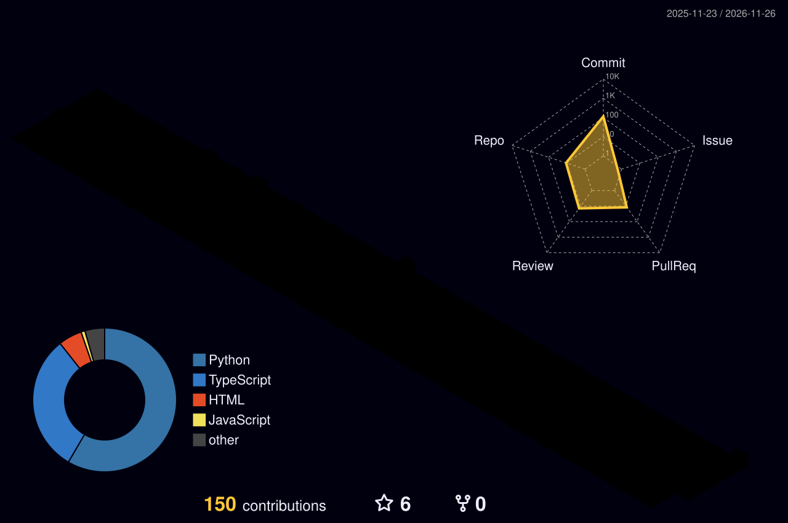

<!-- ═══════════════ HEADER ═══════════════ -->
<p align="center">
  
</p>

<p align="center">
  
</p>

<p align="center">
  
  
  
</p>

<p align="center">
  <a href="https://www.linkedin.com/in/davidkoka"></a>
  <a href="https://devdav.vercel.app/"></a>
  <a href="https://github.com/devDav65"></a>
</p>


<!-- ═══════════════ À PROPOS ═══════════════ -->
## 👨‍💻 À propos de moi · About me

<table>
<tr>
<td width="55%">

🇫🇷 **Français**
- 🎓 Étudiant en Génie Logiciel à **Lomé, Togo**
- 🔥 Dev **Full-Stack** : j'aime autant le backend (Java/Spring, Django, FastAPI) que le front (Next.js)
- 🌍 Je construis des solutions pour le **contexte africain** (FCFA, fintech, santé, immobilier…)
- 🐧 Utilisateur d'**Arch Linux** (oui, je vais te le dire)
- 🔐 Curieux de **cybersécurité** et d'**admin système**
- ⚡ Fun fact : je transforme les bugs en features

🇬🇧 **English**
- 🎓 Software Engineering student based in **Lomé, Togo**
- 🔥 **Full-Stack** dev: backend (Java/Spring, Django, FastAPI) and frontend (Next.js)
- 🌍 Building solutions for the **African context** (payments, health, real estate…)
- 🐧 **Arch Linux** user (yes, I'll tell you)
- 🔐 Into **cybersecurity** and **sysadmin**

</td>
<td width="45%" align="center">


</td>
</tr>
</table>

### 🐧 `neofetch`

```bash
david@archlinux:~$ neofetch

        /\          david@archlinux
       /  \         ────────────────────────────────────
      /\   \        OS ......... Arch Linux (btw)
     /      \       Role ....... Full-Stack Developer
    /   ,,   \      Langages ... Java · Python · JavaScript
   /   |  |  -\     Frameworks . Spring Boot · Django · FastAPI · Next.js
  /_-''    ''-_\    Data ....... PostgreSQL · Redis
                    Ship ....... Docker
                    Home ....... Lomé, Togo 🇹🇬
                    Status ..... ☕ chargé en café, prêt à compiler
```


<!-- ═══════════════ STACK ═══════════════ -->
## 🛠️ Ma stack · My stack

<p align="center">
  
</p>

<p align="center">
  
  
  
  
  
  
  
  
  
  
  
  
</p>


<!-- ═══════════════ SNAKE ═══════════════ -->
## 🐍 Le serpent affamé · The hungry snake

<p align="center">
  <picture>
    <source media="(prefers-color-scheme: dark)" srcset="https://raw.githubusercontent.com/devDav65/devDav65/output/github-snake-dark.svg" />
    <source media="(prefers-color-scheme: light)" srcset="https://raw.githubusercontent.com/devDav65/devDav65/output/github-snake.svg" />
    
  </picture>
</p>

<p align="center"><i>Il mange mes contributions. Je continue de les nourrir. · It eats my contributions. I keep feeding it.</i></p>

<!-- ═══════════════ PROJETS ═══════════════ -->
## 🚀 Projets · Projects

<p align="center">
  <a href="https://github.com/devDav65/miniserver"></a>
  <a href="https://github.com/devDav65/text-to-sql"></a>
</p>
<p align="center">
  <a href="https://github.com/devDav65/Chat"></a>
  <a href="https://devdav.vercel.app/"></a>
</p>


<!-- ═══════════════ 3D ═══════════════ -->
## 🌆 Ma ville de contributions en 3D · My 3D contribution city

<p align="center">
  
</p>

<!-- ═══════════════ STATS ═══════════════ -->
## 📊 Stats GitHub

<p align="center">
  
  
</p>

<p align="center">
  
</p>

<p align="center">
  
</p>

### 🏆 Trophées · Trophies

<p align="center">
  
</p>


<!-- ═══════════════ OBJECTIFS ═══════════════ -->
## 🎯 Ce que je cherche · What I'm looking for

| | 🇫🇷 | 🇬🇧 |
|---|---|---|
| 💼 | Stage / alternance / premier job en dev | Internship / junior dev opportunities |
| 🤝 | Collaborations sur des projets open source ou startups | Open source & startup collaborations |
| 🧑‍💻 | Missions freelance (web, API, plateformes) | Freelance gigs (web, APIs, platforms) |
| 📚 | Apprendre, progresser, partager | Learn, grow, share |

<p align="center">
  
</p>

<p align="center">
  
</p>

<!-- ═══════════════ EASTER EGG ═══════════════ -->
<details>
<summary>🎁 <b>Clique ici, surprise ! · Click here, surprise!</b></summary>
<br>

```bash
$ sudo make me a sandwich
david is not in the sudoers file. This incident will be reported. 🥪
```

> 🇫🇷 Si tu lis ça, tu as bon goût. Dis-moi bonjour sur [LinkedIn](https://www.linkedin.com/in/davidkoka) 😄
> 🇬🇧 If you're reading this, you have great taste. Say hi on [LinkedIn](https://www.linkedin.com/in/davidkoka) 😄

</details>

<!-- ═══════════════ FOOTER ═══════════════ -->
<p align="center">
  
</p>
